# 星链·AI 选品营销工作台 — 系统架构设计

> 版本：v1.2（2026-10-13 合规同步，变更记录见下） · 日期：2026-10-13 · 配套文档：[01-需求说明书](./01-需求说明书.md)
>
> **v1.2 变更记录（2026-10-13，T-M1-01；授权依据 [05-AI开发计划与里程碑](./05-AI开发计划与里程碑.md):87，书面复审依据 04:118）**——本次仅以下六处授权区变更，其余章节零改动：
> 1. 版本头：升 v1.2 并记录变更（本段）；
> 2. §4.2 llm-gateway：补「调用前预处理去标识化（默认开启，PC-03）」（06:179）；
> 3. §6.2 发布 DAG：补内容合规三道闸节点（实现归 M3：T-M3-01/03/05）（06:177）；
> 4. §7.5：适配层升 DSL v1.1（version/minEngineVersion/verify/nonReentrant/blockedFeatures/terms 组合建模）+ 新增「DSL v1.1 规范参数表」（04:43-48 S2、04:93 S10、03:218 B-4）；
> 5. §12.1 遥测服务：补 consent 标志、event 枚举与 anon_user_hash 匿名口径（06:178 PC-02）；
> 6. §13 协议：/api/v1/telemetry/events 行补事件字段（同上）。
> 历史：v1.1（2026-10-10 对齐修正：套餐 tier 建模 / 许可证 device_limit / 采集量额语义 / 报告八章枚举）。
> 需求追溯：文中 FR-x / NFR-x 编号均引用自需求说明书。

---

## 目录

- [1. 架构总览](#1-架构总览)
- [2. 总体架构图](#2-总体架构图)
- [3. 技术选型与决策记录（ADR）](#3-技术选型与决策记录adr)
- [4. C 端 Electron 客户端架构](#4-c-端-electron-客户端架构)
- [5. 受控浏览器与 CDP 接管设计](#5-受控浏览器与-cdp-接管设计fr-3)
- [6. 工作流引擎设计](#6-工作流引擎设计)
- [7. 反爬与拟人中间件](#7-反爬与拟人中间件prd-53-的工程落地)
- [8. Agent 运行时与三个独立 Agent](#8-agent-运行时与三个独立-agent)
- [9. 核心链路时序与状态机](#9-核心链路时序与状态机)
- [10. 日志、审计与成本计量](#10-日志审计与成本计量fr-10--nfr-8)
- [11. 安全架构](#11-安全架构prd-5-威胁模型逐条落地)
- [12. B 端后台与授权服务架构](#12-b-端后台与授权服务架构)
- [13. 接口设计（摘要）](#13-接口设计摘要)
- [14. 数据模型](#14-数据模型)
- [15. 部署、更新与配置下发](#15-部署更新与配置下发)
- [16. 分阶段交付路线图](#16-分阶段交付路线图)
- [17. 风险登记册](#17-风险登记册)

---

## 1. 架构总览

### 1.1 设计目标

| 目标 | 说明 | 对应需求 |
|---|---|---|
| 密钥不出端 | 用户 LLM Key、平台登录态只存本机，服务端零接触 | FR-2.2 / FR-3.2 |
| 工作流可断点续跑 | 任何崩溃/断网/重启后从检查点恢复，发布零重复 | NFR-3 |
| 平台适配热更新 | 小红书/1688 改版后选择器与流程脚本可远程热修 | NFR-7 |
| 风控优先于效率 | 一切自动化经过频控/熔断，阈值服务端可远程下调 | FR-4.3 / FR-9.5 |
| 全链路可审计 | 每个动作有日志、截图、trace_id 可回放 | FR-10 |

### 1.2 架构原则

1. **Local-First**：采集数据、素材、日志全部本地持久化（SQLite + 文件），服务端只存账号、会员、订单、最小化遥测；
2. **人机共驾**：AI 生成 → 待审池 → 人工确认 → 自动化执行，确认动作本身是状态机的一部分；
3. **策略与执行分离**：选择器/流程脚本/反爬参数是「数据」（可热更），引擎内核是「代码」（随版本发布）；
4. **单租户桌面**：客户端服务单用户，不做云端代跑，天然规避多账号关联风险。

### 1.3 系统上下文

- **C 端 Electron 客户端**：唯一执行体，内含浏览器自动化、工作流引擎、Agent 运行时、本地存储；
- **B 端 Web 后台 + 服务端**：账号/会员/支付/配置下发/遥测/管理后台，业务上是「轻后端」；
- **外部依赖**：用户自备的 OpenAI 兼容 LLM 服务、微信/支付宝支付、小红书与 1688 页面（用户自有登录态）。

---

## 2. 总体架构图

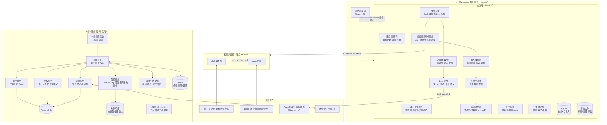

**读图要点**

- 客户端与小红书/1688 之间**没有任何我方服务器中转**：自动化发生在用户本机的受控浏览器内；
- LLM 流量从客户端**直连**用户自配服务商，携带用户自己的 Key；
- 服务端只做：账号、授权、支付、配置/热更、（授权后的）崩溃与埋点收集；
- 选择器热更包经签名后由 CFGS 下发，客户端验签生效。

---

## 3. 技术选型与决策记录（ADR）

### 3.1 选型总表

| 层 | 选型 | 备选（否决原因） |
|---|---|---|
| 桌面壳 | **Electron 33+（electron-builder）** | Tauri（WebView2 依赖 + Node 生态弱，CDP 库与 SQLite 生态不如 Node 直接） |
| 前端 | React 18 + TypeScript + Vite + Zustand + TanStack Query + Ant Design / Tailwind | — |
| 浏览器自动化 | **Playwright（connectOverCDP 模式）** | Puppeteer（API 亦可，Playwright 的帧定位/等待语义更稳）；Selenium（指纹特征明显） |
| 本地 DB | **SQLite（better-sqlite3 + drizzle）**，WAL 模式 | LevelDB（SQL 查询弱） |
| 本地向量检索 | sqlite-vec（或本地嵌入缓存表） | 引入完整向量库过重 |
| LLM 接入 | openai SDK 指向自定义 base_url；**主流程用结构化输出（JSON Schema）**，工具调用用于 Agent | LangChain（重，V1 不引入框架锁定） |
| 状态机/编排 | **XState v5**（任务状态机）+ 自研轻量 DAG 执行器（步骤 = 纯函数 + 检查点） | Temporal（云端编排，违背 Local-First） |
| 日志 | pino（NDJSON 滚动文件）+ SQLite 索引表 | winston 亦可，pino 性能优 |
| B 端框架 | **NestJS + Prisma + PostgreSQL + Redis** | — |
| B 端前端 | React + Ant Design Pro | — |
| 部署 | Docker Compose 起步（单机）→ K8s（增长后） | — |
| 密钥体系 | Ed25519 签发许可证 JWT；客户端内嵌公钥 | — |
| 崩溃收集 | Sentry（可私有化部署） | — |

### 3.2 关键决策记录

| ADR | 决策 | 理由与代价 |
|---|---|---|
| ADR-1 桌面壳选 Electron | 放弃 Tauri | CDP 自动化依赖 Node 生态（playwright、better-sqlite3），Electron 主进程即 Node，零桥接成本；代价是包体积 ~180MB，用 asar + 差量更新缓解 |
| ADR-2 自动化走「真实浏览器 + CDP 接管」而非无头/API 逆向 | 不用无头、不逆向接口 | 用户登录态与指纹真实一致，风控暴露面最小；符合「不绕过反爬」的合规定位；代价是 UI 变更敏感 → 由平台适配层热更新对冲（ADR-5） |
| ADR-3 本地优先存储 | 业务数据全部本地 SQLite | 隐私合规与成本双赢；代价是跨设备不同步（V1 接受，二期评估端到端加密同步） |
| ADR-4 BYOK 且 Key 不出端 | 不做云端 LLM 代理 | 杜绝「我方泄露用户 Key」的信任风险与合规责任；代价是失去统一计量（用本地用量面板补偿） |
| ADR-5 平台适配层数据化 + 签名热更 | 选择器/流程脚本下发 | 平台改版 24h 内可热修，不发版；代价是要做签名校验与版本兼容矩阵 |
| ADR-6 执行器单串行 | 同一受控浏览器同时只跑一个自动化任务 | 拟人速率下并发无意义且放大风控；队列即可满足吞吐；二期多 Profile 再评估并行 |

### 3.3 语言与工程规范

全仓库 TypeScript（含 Electron 主进程与 B 端），Monorepo（pnpm workspace）：

```
apps/
  desktop/          # Electron 客户端（main/ + renderer/ + preload/）
  server/           # NestJS 服务端
  admin/            # B 端管理后台 SPA
packages/
  protocol/         # 前后端共享类型与 API 契约（zod schema）
  adapters-xhs/     # 小红书适配层（选择器+流程脚本，热更包源）
  adapters-1688/    # 1688 适配层
  humanize/         # 拟人操作与节奏引擎
  workflow/         # DAG 执行器 + XState 定义
  agents/           # Agent 运行时与三个业务 Agent
  llm-gateway/      # LLM 网关
  logger/           # 日志与 trace
```

---

## 4. C 端 Electron 客户端架构

### 4.1 进程模型

| 进程 | 职责 | 边界 |
|---|---|---|
| 主进程（main） | 全部能力层：窗口、自动化、工作流、DB、网络 | 唯一直接持有 Node 能力 |
| 预加载（preload） | contextBridge 暴露**白名单 API**（invoke 通道 + 参数 zod 校验） | 不暴露 ipcRenderer 本体 |
| 渲染进程（renderer） | 纯 UI：React SPA，sandbox: true，contextIsolation: true，禁用 nodeIntegration | 不可直接访问文件/网络系统 API |
| 受控浏览器 | 独立 Chrome/Edge/内置 Chromium 进程，远程调试端口仅绑 127.0.0.1 | 与用户日常浏览器完全隔离 |

### 4.2 主进程模块清单

| 模块 | 职责 | 关键设计 |
|---|---|---|
| shell | 窗口生命周期、托盘、通知、菜单、自动更新（§15） | 单实例锁；深链 xlink:// 处理 |
| license-manager | 许可证验签、设备绑定、72h 宽限缓存、到期锁定入口 | Ed25519 验签；状态变更广播到 UI |
| key-vault | LLM Key 加密存取（DPAPI/Keychain）、多 Key 故障转移 | 内存中解密即用即弃；UI 只显示脱敏 |
| workflow-engine | DAG 编排、XState 状态机、检查点、任务队列、断点续跑 | §6 详述 |
| agent-runtime | 三个独立 Agent 的执行环境（工具表/记忆/反思/预算） | §8 详述 |
| llm-gateway | OpenAI 兼容调用、重试/退避、token 计量、响应缓存、JSON Schema 校验；**调用前预处理去标识化（默认开启，PC-03）**：昵称/ID→稳定假名、粉丝数→量级分桶，仅清洗发往 LLM 的 payload，本地原文不动 | 统一 trace_id；成本写日志 |
| browser-service | 受控浏览器拉起、CDP 连接池、页签/上下文管理、会话健康检测 | §5 详述 |
| humanize | 贝塞尔鼠标、拟人输入、滚动与停留、随机节奏 | §7 详述 |
| stealth-middleware | 配额计数、熔断状态机、风控信号监听 | §7 详述 |
| adapter-loader | 平台适配层加载、热更包验签/回滚、自检用例 | §7.5 / §15 详述 |
| logger | pino NDJSON + SQLite 索引、截图存证、trace_id 贯穿 | §10 详述 |
| store | better-sqlite3 + drizzle；迁移管理（按版本号迁移链） | §14 详述 |
| config | 本地设置、B 端下发配置合并（下发阈值优先级高） | 冲突时取更保守值 |
| backup | 备份包导出/导入（AES-256 可选密码） | FR-12.4 |

### 4.3 IPC 契约（示例）

所有 IPC 走 `invoke/handle`，通道即契约，入参在 preload 侧用 zod 校验：

| 通道 | 参数 → 返回 | 说明 |
|---|---|---|
| `workflow:start` | { kind: "selection"\|"publish"\|"promo", input } → { taskId } | 创建并入队 |
| `workflow:control` | { taskId, op: "pause"\|"resume"\|"cancel" } → { state } | 任务控制 |
| `workflow:events` | （webContents.send 推送）| 状态/进度/待确认事件流 |
| `browser:openPlatform` | { platform: "xhs"\|"1688" } → { attached, loggedIn } | FR-3.1/3.2 |
| `review:list` / `review:decide` | 待审池读取与批量确认 | FR-8.4 / FR-9.2 |
| `keys:set` / `keys:verify` | Key 配置与连通性验证 | FR-2.1/2.3 |
| `logs:query` / `logs:export` | 日志检索与导出 | FR-10 |

---

## 5. 受控浏览器与 CDP 接管设计（FR-3）

### 5.1 拉起与接管流程

1. **浏览器解析**（M2 内置优先）：优先用户设置 → 内置便携 Chromium（应用托管，按需下载 npmmirror 快照 + revision/SHA-256 双 pin 校验，检测见 docs/adr/notes-browser-builtin.md）→ 本机 Chrome/Edge 兜底（自动探测）；
2. **拉起参数**：`--remote-debugging-port=0`（随机端口，仅 127.0.0.1）、`--user-data-dir=<app>/profiles/<platform>`（**每平台独立 Profile**）、禁用 automation 提示条；
3. **接管**：读取 DevToolsActivePort → `playwright.chromium.connectOverCDP(wsEndpoint)` → 枚举现有 context/page，**不新建隐身上下文**（保持真实指纹与登录态）；
4. **登录引导**：打开平台首页 → 会话健康检测（探测「登录后元素」存在性）→ 未登录则在 UI 提示「请在浏览器内完成扫码登录」，轮询至登录成功；
5. **让位机制**：CDP 监听输入事件与页面 focus，检测到人工操作即暂停自动化步骤（状态机进入 `yielded`），人工停止操作 N 秒后恢复或提示用户确认恢复。

### 5.2 会话与多账号

- Cookie/Storage 由浏览器 Profile 自身管理，客户端代码**永不读取/导出 Cookie 内容**；
- 会话失效检测：每次任务开始前 + 长任务每 30 分钟，访问轻量页面校验登录元素；
- 二期多账号：`profiles/<platform>/<accountAlias>` 目录隔离，任务绑定 Profile 执行。

### 5.3 连接韧性

- CDP 断连（浏览器被关/崩溃）→ 任务进入 `suspended`，自动尝试重拉浏览器并恢复到检查点；
- 端口随机化 + 仅本地回环，防止本机其他进程恶意连入调试口；二期评估 `--remote-debugging-pipe` 进一步收敛暴露面。

---

## 6. 工作流引擎设计

### 6.1 模型：DAG + 状态机 + 检查点

- **任务（Task）**：一次工作流运行，拥有 XState 状态机（§9.1）；
- **步骤（Step）**：DAG 节点，纯函数签名 `(ctx, input) => output`，声明 `id / needs / checkpoint / humanGate / retry`；
- **检查点（Checkpoint）**：步骤成功后把 output 落 `task_steps` 表；恢复时按 DAG 拓扑序跳过已完成步骤；
- **人工闸门（humanGate）**：步骤产出进入待审池，任务挂起等待 `review:decide`，确认后才推进——**确认动作幂等**；
- **队列**：单浏览器串行执行（ADR-6），优先级 + FIFO；任务可暂停/继续/取消，取消语义 = 当前步骤安全点停止。

### 6.2 三大工作流 DAG

**选品工作流（selection）**


> 量额语义（对齐报告 D-03）：单主题采集按 §7.1 日配额硬上限限速，超出部分自动跨日续采；「主题上限 200 条（可配 50–1000）」为主题总量上限，不构成对日配额的突破。

**发布工作流（publish）**

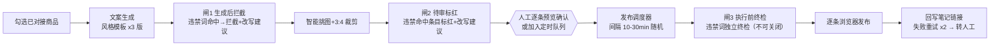

> 内容合规三道闸（生成后拦截 → 待审标红 → 执行前终检，PC-05）：本节固定节点位置与语义，**实现归 M3（T-M3-01/03/05）**；违禁词库与命中扫描由 T-M1-08 提供（FR-8.8）。

**推广工作流（promo）**

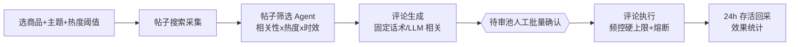

### 6.3 失败与补偿

| 场景 | 策略 |
|---|---|
| 步骤瞬时失败（网络/DOM 未加载） | 指数退避重试 ≤3 次 |
| 页面结构变更（选择器失配） | 标记 adapter_fault → 自检用例复验 → 触发热更检查 → 仍失败转人工并上报 |
| 风控信号（验证码/429） | 熔断器打开（§7.3），任务挂起，冷却 30 分钟，人工确认后恢复 |
| 发布/评论类**不可重入**步骤 | 执行前写「意图记录」（idempotency_key），恢复后先核对页面是否已成功（搜索草稿/评论列表），成功则跳过——保证零重复（NFR-3） |
| 进程崩溃 | 启动时扫描 `tasks.status IN (running, suspended)`，全部进入恢复流程 |

---

## 7. 反爬与拟人中间件（PRD §5.3 的工程落地）

> 定位声明：本模块的目标是让自动化**行为速率与分布拟人化、风控信号可熔断**，而不是绕过平台安全机制。所有阈值由 B 端配置服务下发收紧，客户端只取更保守值。

### 7.1 节奏引擎（PacingEngine）

| 参数 | 默认值 | 说明 |
|---|---|---|
| 页面间停留 | 截断正态 N(5s, 2s)，[3s, 8s] | 阅读拟人 |
| 详情页阅读时长 | N(8s, 3s)，[4s, 15s] | 随正文长度线性修正 |
| 滚动 | 分段滚动 300–700px/次，随机停顿 | 触发懒加载且拟人 |
| 时段限制 | 02:00–07:00 禁跑 | 可配置 |
| 日配额 | 采集 300 条 / 评论 30 条 / 发布 10 条 | **硬上限，UI 只能下调** |
| 并发 | 1（单浏览器串行） | ADR-6 |

### 7.2 拟人操作层（Humanizer）

- 鼠标：贝塞尔曲线（随机控制点）+ 过冲/修正抖动 + 变速移动；点击位置在元素 bbox 内高斯偏移；
- 键盘：逐字符输入，间隔 60–180ms，偶发退格修正；
- 页面操作：优先模拟真实交互（click/scroll/type），禁用 JS 直取 DOM 写入；
- 指纹降噪（保守项）：去除 `navigator.webdriver`、关闭自动化提示条、保持真实 UA/视口；**不做** Canvas/WebGL 深度伪造（单一真实 Profile 原则，避免指纹自相矛盾触发风控）。

### 7.3 熔断器（CircuitBreaker）与风控信号

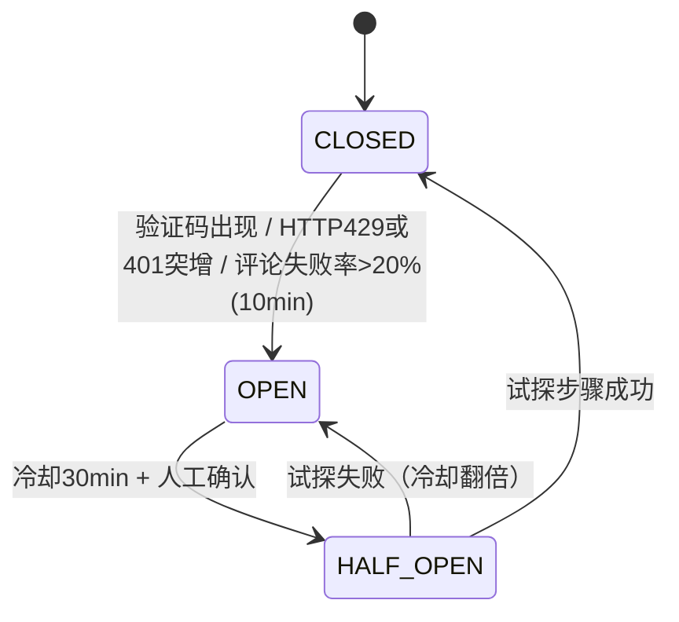

- 信号源：页面 DOM 检测（验证码组件）、网络层状态码统计、步骤失败率滑动窗口；
- OPEN 态：暂停所有任务 → 桌面通知 + 客户端弹窗 → 引导用户人工完成验证后手动恢复；
- 熔断事件全量上报遥测（不含内容），B 端聚类后触发应急预案（PRD §5.7）。

### 7.4 可借鉴的开源项目（对应原需求 4.1「github 高星项目借鉴」）

| 项目 | 借鉴点 | 用法 |
|---|---|---|
| **DrissionPage** | 国产高星 CDP 库，页面接管与元素操作 API 设计、拟人化思路成熟 | 设计参考；评估作为 Playwright 之外的备选驱动 |
| **puppeteer-extra-plugin-stealth** | 指纹降噪项清单（webdriver、plugins、languages…） | 借鉴其**低风险子集**，逐项评估后手工实现 |
| **rebrowser-playwright / rebrowser-patches** | CDP 运行时指纹泄露点（Runtime.enable 等）的研究 | 参考其检测页自测，选用保守补丁 |
| **Crawlee** | 请求队列、会话池、自动重试、统计的架构 | 借鉴队列与统计设计（运行于浏览器内页面调度场景） |
| **MediaCrawler** | 小红书字段结构与页面交互路径 | **仅作字段研究参考**；本项目不做接口逆向、不使用其签名方案 |
| **p-retry / p-limit** | 退避重试与并发原语 | 直接依赖 |

### 7.5 平台适配层（Adapter）——DSL v1.1

> DSL v1.1（2026-10-13，T-M1-01）：按 04:43-48（S2：verify 声明 + nonReentrant 强制）、04:93（S10：DSL semver + minEngineVersion）、03:218（B-4：关键词组合语义）修订；v1.0 的「纯数据结构 / 签名热更 / 特征校验」三原则保留。实现载体：T-M1-02（适配层框架）、T-M1-03（反爬中间件消费下方参数表）。

- 结构（v1.1）：`{ platform, version, minEngineVersion, selectors: {...}, flows: { search, detail, publish, comment... }, verify: {...}, blockedFeatures: [...], selfcheck: [...] }`，纯数据 + 声明式流程描述（步骤 DSL），不含可执行 JS（安全边界）；
- **version / minEngineVersion（S10）**：DSL 包按 semver 版本化（`version`），并声明所需引擎最低版本（`minEngineVersion`）；客户端引擎声明自身 DSL 引擎版本，加载期做兼容检查——`minEngineVersion` 高于引擎版本的包**直接拒绝激活**（不降级运行），失败时沿用 §15.2 的回滚行为；
- **verify 声明（S2）**：与 `flows` 同级、同样随热更包签名下发（同签名热更）。语义 = 不可重入步骤恢复时的「页面是否已成功」核对声明（如 `publish.verify: 草稿箱存在含标题 X 的笔记`、`comment.verify: 评论区可见文本 Y`）；步骤以 `nonReentrant: true` 标记时，引擎**强制要求**对应 verify 声明存在，缺失则该包在**加载期**拒绝激活（校验前置，不留给运行时）。恢复流程：先执行 verify 核对 → 已成功则跳过重放，未成功才重新执行——把 §6.3 的「核对页面是否已成功」从硬编码收敛为可热更声明，保证崩溃恢复零重复（NFR-3）；
- **blockedFeatures**：验证码等风控特征选择器列表（如验证码容器选择器）；任一 flow 执行期命中 → 上报风控信号 → 熔断器介入（§7.3），当前步骤安全点挂起；
- **terms 关键词组合建模（B-4 语义写死）**：search flow 查询声明支持 `terms[]`（**≤5 个**）与 `operator: "and" | "or"`。**OR** = 按词分次查询、结果并集、按 `note_id` 去重；**AND** = 单次查询提交平台 + 客户端过滤（标题/正文必须全词命中）；超出平台检索表达能力的组合一律由客户端分次检索后本地合并（03:218 B-4 处置语义）；
- 热更（v1.1 链路，校验点扩容）：签名包 → 验签 → semver/minEngineVersion 兼容检查 → 自检用例（在无害页面回放选择器）通过才激活，任一步失败自动回滚上一版本；
- 每个 flow 步骤声明「预期页面特征」，执行时先校验特征再操作，把「页面改版」变成可检测事件而非误操作。

#### DSL v1.1 规范参数表（引用值）

> 汇总 §7.1–§7.3 既有硬数值与 §7.5 v1.1 新增约束，供实现卡直接抄：T-M1-02（适配层/DSL 解析）、T-M1-03（节奏/Humanizer/熔断）。**出处行号为 v1.1 版本行号**（与 03/04/05/06 评审链及执行计划的既有引用口径一致）；B 端下发收紧时恒取更保守值。

| 参数名 | 值 | 出处（§ / v1.1 行号） |
|---|---|---|
| pacing.page_dwell | 截断正态 N(5s, 2s)，截断 [3s, 8s] | §7.1（:327） |
| pacing.detail_read | N(8s, 3s)，截断 [4s, 15s]，随正文长度线性修正 | §7.1（:328） |
| pacing.scroll | 分段滚动 300–700px/次，随机停顿 | §7.1（:329） |
| pacing.quiet_hours | 02:00–07:00 禁跑（可配置） | §7.1（:330） |
| quota.daily_hard_cap | 采集 300 条 / 评论 30 条 / 发布 10 条；**硬上限，UI 只能下调** | §7.1（:331） |
| concurrency.max | 1（单浏览器串行，ADR-6） | §7.1（:332） |
| humanizer.mouse | 贝塞尔曲线（随机控制点）+ 过冲/修正抖动 + 变速移动；点击位置在元素 bbox 内高斯偏移 | §7.2（:336） |
| humanizer.keyboard | 逐字符输入，间隔 60–180ms，偶发退格修正 | §7.2（:337） |
| humanizer.actions | 优先模拟真实交互（click/scroll/type），禁用 JS 直取 DOM 写入 | §7.2（:338） |
| humanizer.fingerprint_floor | 仅保守降噪（去 navigator.webdriver、关自动化提示条、真实 UA/视口）；**不做** Canvas/WebGL 深度伪造 | §7.2（:339） |
| breaker.open_signals | 验证码出现 / HTTP 429 或 401 突增 / 评论失败率 >20%（10min 窗口） | §7.3（:346） |
| breaker.cooldown_to_half_open | 冷却 30min + 人工确认 | §7.3（:347） |
| breaker.half_open_probe | 试探成功→CLOSED；试探失败→OPEN 且**冷却翻倍**（60min） | §7.3（:348-349） |
| breaker.telemetry | 熔断事件全量上报遥测（不含内容），B 端聚类触发应急预案 | §7.3（:354） |
| dsl.terms.max_terms | 5 | §7.5 v1.1（B-4） |
| dsl.terms.operator | `and` / `or`（OR=并集按 note_id 去重；AND=单查询+标题正文全词命中） | §7.5 v1.1（B-4） |
| dsl.versioning | version = semver；minEngineVersion 不兼容 → 拒绝激活 | §7.5 v1.1（S10） |
| dsl.nonReentrant | 标记步骤强制要求 verify 声明存在，缺失拒绝激活 | §7.5 v1.1（S2） |

---

## 8. Agent 运行时与三个独立 Agent

### 8.1 运行时（AgentRuntime）

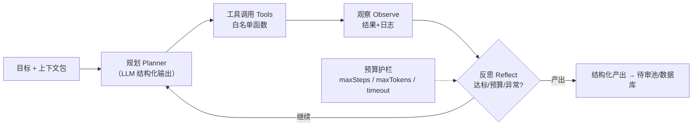

- **工具白名单**：Agent 可调用的只有注册工具（如 `search_notes`, `fetch_note_detail`, `search_1688`, `save_material`, `compose_message`），每个工具有参数 schema、速率限制、是否需要人工闸门；
- **记忆**：短期 = 会话内 scratchpad（任务库表）；长期 = 本地向量库（sqlite-vec）存用户偏好与历史决策，**仅本地**；
- **可学习**：人工对待审池/候选清单的采纳与淘汰行为写入偏好画像表，作为 few-shot 与评分加权信号回流（FR-6.7 / FR-9.8）；
- **护栏**：每任务 maxSteps（默认 40）/ maxTokens（默认 300k）/ 超时（30min）；超限自动收敛产出或转人工；
- **确定性**：结构化输出 + JSON Schema 校验，失败自动纠偏重试 2 次；Agent 产出**永不直接执行**，一律过待审池或评分落库。

### 8.2 需求报告 Agent（report-agent）

| 项 | 内容 |
|---|---|
| 输入 | 主题 + 清洗后笔记集（含互动数据） |
| 工具 | 本地嵌入聚类（BGE 类小模型本地推理或用户 LLM 嵌入接口）、统计聚合、LLM 分析 |
| 产出 | 报告 JSON（PRD FR-5.2 八章节：①场景聚类与热度 ②痛点TopN ③购买决策因素 ④价格带分布 ⑤竞品内容打法 ⑥内容机会点 ⑦1688选品关键词建议 ⑧数据来源与方法说明） |
| 学习信号 | 用户对报告章节的编辑/删除、关键词的采纳 |

### 8.3 1688 选品 Agent（selection-agent）

| 项 | 内容 |
|---|---|
| 输入 | 关键词建议 + 评分权重（用户可调） |
| 工具 | `search_1688`（页面检索）、`fetch_product`、`score`（确定性评分函数，非 LLM）、`compose_inquiry`（询盘话术）、`favorite_shop`、`save_material` |
| 评分模型 | 综合分 = Σ 维度分 × 权重；维度：价格分位（同关键词价格比价）、起订量、销量/复购率、供应商等级（诚信通年限/实力商家/超级工厂映射分）、货描/响应/回头率（平台公开分）、一件代发标识；每维输出分值+理由（可解释） |
| 产出 | 候选清单（Top 30）→ 人工勾选 → 收藏+询盘（确认后）→ 素材留存商品卡片 |
| 学习信号 | 勾选/淘汰 → 调整维度权重先验与偏好特征（如"偏好低 MOQ"） |

### 8.4 帖子筛选 Agent（promo-filter-agent）

| 项 | 内容 |
|---|---|
| 输入 | 主题搜索结果 + 热度阈值 + 商品上下文 |
| 工具 | `search_notes`、`fetch_note_detail`、`classify_post`（LLM 分类：软文/竞品/官媒/真实讨论）、`score_relevance`、`check_history`（已评论排重） |
| 产出 | 排序候选帖列表，每条附：相关性分、类目、筛选理由、建议评论角度 |
| 学习信号 | 待审池中人工删除/采纳 → 负例/正例库，优化分类 prompt 与阈值 |

---

## 9. 核心链路时序与状态机

### 9.1 任务统一状态机（XState）

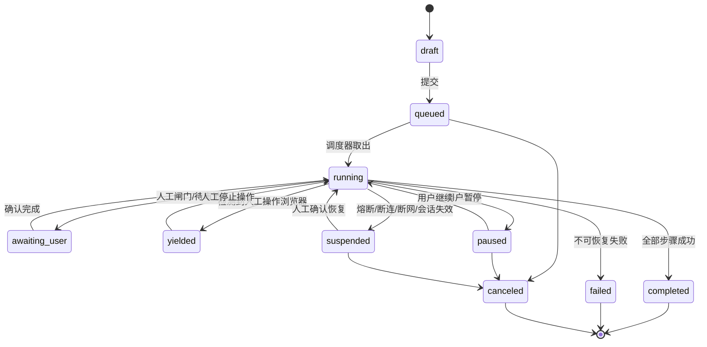

持久化规则：每次状态迁移写入 `tasks` + `task_events`；`running` 状态任务在启动恢复流程中一律降级为 `suspended` 后按检查点续跑。

### 9.2 选品链路时序（含货源对接触发）

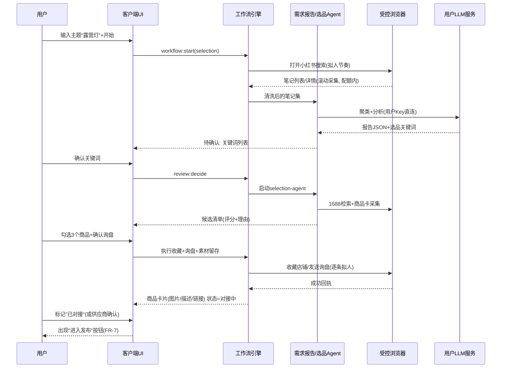

### 9.3 发布链路时序（幂等防重）

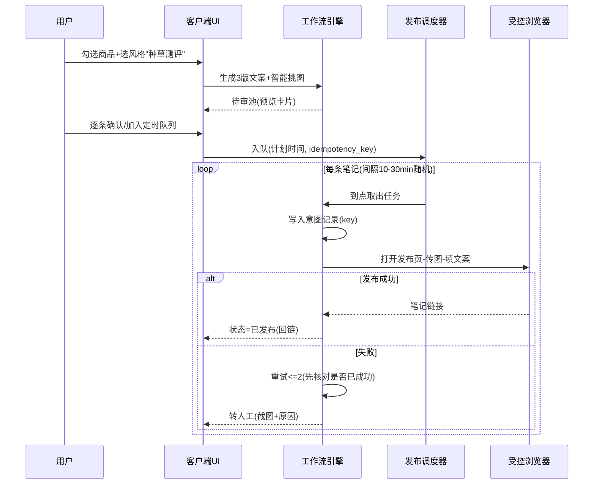

### 9.4 推广链路时序（频控与熔断）

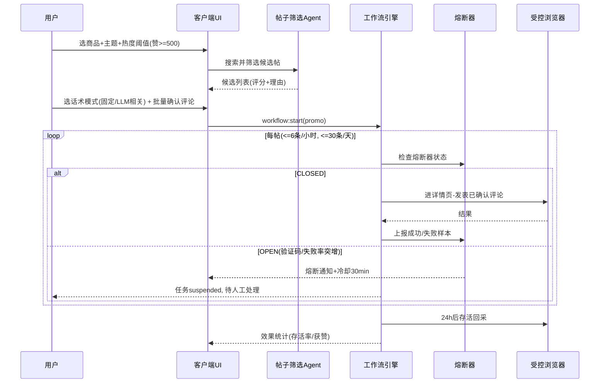

### 9.5 许可证签发与验签时序

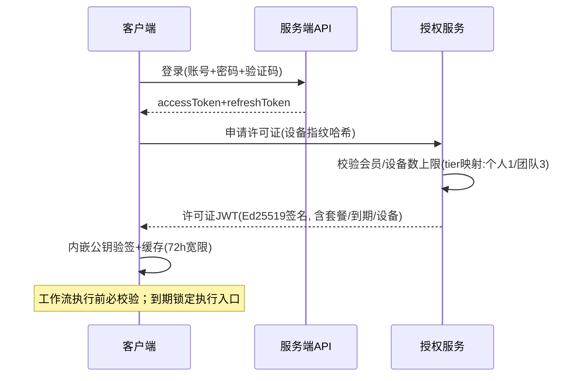

---

## 10. 日志、审计与成本计量（FR-10 / NFR-8）

### 10.1 五类日志与落点

| 类别 | 内容 | 落点 | 保留 |
|---|---|---|---|
| user_action | 点击、确认、配置变更 | SQLite `logs` + NDJSON 文件 | 90 天 |
| automation_step | 步骤开始/结束、目标页、结果、**截图路径** | 同上 | 90 天 |
| llm_call | provider、model、prompt 摘要哈希、token in/out、估算成本、耗时、trace_id | 同上 | 90 天 |
| network_meta | 域名、状态码、耗时（**不录 body 与 Cookie**） | 同上 | 30 天 |
| system_error | 异常堆栈、版本、OS | 同上 + 授权后 Sentry | 90 天 |

### 10.2 trace 模型

- 每个任务一个 `trace_id`，步骤级 `span_id`；UI 时间线 = 按 trace_id 聚合的 span 瀑布图 + 截图缩略；
- 截图策略：步骤失败必截、人工闸门前后必截、抽样 5% 成功步骤截；图片落 `assets/shots/`，DB 存相对路径与哈希。

### 10.3 成本计量

- LLM 成本 = token × 用户配置单价（预设价可改）；按任务/天/月聚合，UI 用量面板（FR-2.5）；
- 任务级成本上限：单任务成本超阈值（默认 ¥5）弹确认，防止 Agent 失控烧钱。

### 10.4 审计与导出

- 导出：JSON/CSV，含 trace 树与截图打包（zip）；
- 客服协作：用户授权后上传脱敏日志包（自动剔除标题/正文中的手机号、微信号正则命中项）；
- B 端后台操作全部写审计表（谁、何时、对哪个对象、改了什么），FR-11.7。

---

## 11. 安全架构（PRD §5 威胁模型逐条落地）

### 11.1 威胁 → 控制矩阵

| 威胁（PRD §5.1） | 架构控制 | 落点 |
|---|---|---|
| 平台风控识别 | 五层策略引擎（节奏/行为/指纹/熔断/网络）+ 适配层特征校验 | §7 |
| LLM Key 泄露 | DPAPI/Keychain 加密、内存即用即弃、日志脱敏（Key 正则屏蔽）、永不上传 | key-vault |
| 会员破解/共享 | Ed25519 签名许可证 + 设备指纹绑定 + 72h 宽限 + 激活码防爆破 | §9.5 / §12 |
| 客户端逆向/篡改 | asar + 代码混淆（bytenode 评估）、完整性自检、许可证离线验签不依赖可篡改逻辑 | 构建管线 |
| 违禁内容处罚 | 三道闸内容合规管线（生成过滤 → 待审标红 → 执行终检） | PRD §5.5 |
| 服务端拖库 | 最小化存储、密码 BCrypt、字段级加密（手机号）、RBAC + 审计、备份加密 | §12 |

### 11.2 客户端安全细节

- **进程隔离**：sandbox + contextIsolation + 禁用 remote 模块；preload 白名单 IPC，参数 zod 校验；
- **CSP**：渲染进程 `default-src 'self'`，禁 inline script；
- **调试口**：CDP 仅 127.0.0.1 + 随机端口（二期改 pipe）；检测非本机回环连接立即断开；
- **供应链**：依赖锁定 + 安装包签名（Windows 代码签名证书 / macOS notarization）；
- **热更包**：Ed25519 签名 + 版本兼容矩阵 + 自检后激活 + 自动回滚；私钥离线保管。

### 11.3 服务端安全细节

- 全链路 TLS1.2+；密码 BCrypt(cost 12)；刷新 Token 旋转 + 重用检测；
- 登录/兑换/支付回调限流（Redis 令牌桶）；支付回调验签 + 幂等键；
- 激活码仅存哈希；管理员操作二次确认 + 审计；
- OWASP ASVS L2 自查 + 上线前第三方渗透测试（NFR-5）。

### 11.4 隐私设计

- 服务端持有：账号（邮箱哈希可检索加密）、会员、订单、设备指纹哈希、（授权后）崩溃/埋点；
- 服务端**不持有**：LLM Key、平台 Cookie、笔记内容、商品素材、操作日志明细；
- 隐私政策与 EULA 首启确认，版本变更重新确认。

---

## 12. B 端后台与授权服务架构

### 12.1 服务划分（模块化单体起步）

| 模块 | 职责 | 关键接口（§13） |
|---|---|---|
| 账户服务 | 注册/登录/找回/注销、Token 签发 | /api/v1/auth/* |
| 授权服务 | 许可证签发/续期/设备绑定/强制下线 | /api/v1/license/* |
| 订单服务 | 套餐/支付/激活码/退款/发票申请 | /api/v1/orders/* |
| 配置服务 | Feature Flag、限流阈值、适配层热更包版本 | /api/v1/config/* |
| 遥测服务 | 崩溃、熔断事件、匿名漏斗埋点。事件字段（PC-02，zod schema 归 §13 / T-M1-07）：`consent` 同意标志（**未同意不采集不上报**，埋点授权开关独立于崩溃授权）；`event` 枚举：`circuit_open` / `circuit_half_open` / `circuit_closed` / `selfcheck_fail` / `first_collection_completed` / `first_report_generated` / `key_failover`；匿名用户口径 `anon_user_hash`（HMAC 化稳定假名，密钥与账号表隔离存放，不采原始 user_id） | /api/v1/telemetry/* |
| 后台支撑 | 用户/工单/看板/公告/审计 | /api/v1/admin/* |

### 12.2 B 端后台页面结构

```
仪表盘（DAU/收入/漏斗/熔断率）
├─ 用户管理：列表 / 详情(设备·会员·工单) / 禁用·强制下线
├─ 会员与激活码：批次生成 / 导出 / 作废 / 手动延期
├─ 订单中心：支付订单 / 退款审批 / 对账导出
├─ 客服工单：工单流 / 设备解绑审批 / 日志包查看(用户授权)
├─ 风控中心：异常登录 / 爆破告警 / 熔断事件聚类 / 处置记录
├─ 配置中心：Feature Flag / 阈值下发 / 适配层热更包管理(签名上传·灰度)
├─ 内容运营：公告 / 版本与强更策略
└─ 系统：角色权限(RBAC) / 审计日志 / 管理员管理
```

### 12.3 授权模型

- 许可证 JWT claims：`sub(user_id)`, `plan`, `tier`（personal/team）, `device_limit`（tier 映射：个人 1 台 / 团队 3 台）, `exp`, `device_hash`, `jti`（可吊销名单）；
- 验签完全离线（客户端内嵌公钥）；吊销通过 `jti` 名单随配置下发；
- 设备指纹 = SHA256(主板序列号 + 磁盘序列号 + 随机安装 ID)，哈希存储，不采原始值。

### 12.4 扩展性路线

- 起步：NestJS 模块化单体 + PostgreSQL + Redis，Docker Compose 单机即可；
- 增长：按「配置/遥测」先行拆分（读多写少），授权服务保持小而稳；K8s + HPA；对象存储承载热更包与崩溃附件。

---

## 13. 接口设计（摘要）

> 完整契约以 `packages/protocol` 的 zod schema 为准，OpenAPI 由 schema 生成。以下为关键端点。

| 方法 | 路径 | 说明 | 幂等/安全 |
|---|---|---|---|
| POST | /api/v1/auth/register | 邮箱注册（验证码） | 验证码 5 分钟有效 |
| POST | /api/v1/auth/login | 登录 | 失败锁定策略 |
| POST | /api/v1/auth/refresh | 刷新 Token | 旋转 + 重用检测 |
| POST | /api/v1/license/issue | 签发/刷新许可证 | 设备数校验 |
| POST | /api/v1/license/unbind | 解绑设备 | 30 天 1 次限制 |
| POST | /api/v1/orders | 创建订单（套餐/激活码兑换） | 幂等键 |
| POST | /api/v1/orders/callback/wechat | 微信支付回调 | 验签 + 幂等 |
| GET | /api/v1/config/client | 客户端配置（Flag/阈值/吊销名单） | ETag 缓存 |
| GET | /api/v1/config/adapters/latest | 适配层热更包元信息 | 签名校验后下载 |
| POST | /api/v1/telemetry/crash | 崩溃上报（授权后） | 脱敏中间件 |
| POST | /api/v1/telemetry/events | 熔断/漏斗事件；事件体 `{ consent, event, anon_user_hash, payload, at }`，event 枚举见 §12.1；`consent ≠ true` 拒收（PC-02） | 批量 + 采样；consent 强制 |
| GET | /api/v1/admin/users | B 端用户检索 | RBAC |
| POST | /api/v1/admin/cards/batch | 激活码批次生成 | 二次确认 + 审计 |

客户端域内 IPC 契约见 §4.3。

---

## 14. 数据模型

### 14.1 客户端（SQLite，WAL）

| 表 | 关键字段 | 说明 |
|---|---|---|
| notes | id, note_id(唯一), title, content, author_json, likes, collects, comments, tags_json, published_at, collected_at | 笔记主表 |
| note_snapshots | id, note_id, likes, collects, comments, captured_at | 互动快照（FR-4.4） |
| reports | id, topic, cluster_json, content_md, model, token_cost, created_at | 需求报告 |
| products | id, product_id, title, price_min/max, moq, sales, repurchase, supplier_json, scores_json, link, status | 1688 商品（status: 候选/对接中/已对接） |
| materials | id, product_id, kind(image/desc), path, source_url, hash | 素材留存（FR-6.5） |
| tasks | id, kind, state, input_json, priority, idempotency_key, created_at, updated_at | 任务（§9.1 状态机） |
| task_steps | task_id, step_id, status, output_json, checkpoint_at | 检查点 |
| task_events | id, task_id, from_state, to_state, payload_json, at | 状态迁移流水 |
| review_items | id, task_id, kind(note_copy/comment), payload_json, status(待审/采纳/淘汰), decided_at | 待审池 |
| publish_items | id, task_id, product_id, copy_json, images_json, scheduled_at, state, note_url, fail_reason | 发布队列 |
| promo_items | id, task_id, note_id, comment_text, score, reason, state, alive_after24h | 推广执行 |
| llm_calls | id, trace_id, provider, model, tokens_in/out, cost, latency_ms, at | 计量（FR-2.5） |
| logs | id, ts, level, kind, trace_id, span_id, msg, meta_json, shot_path | 五类日志 |
| preferences | id, scope, key, value_json, updated_at | 偏好画像（Agent 学习） |
| kv_config | key, value_json | 本地配置 |

### 14.2 服务端（PostgreSQL）

| 表 | 关键字段 |
|---|---|
| users | id, email(唯一), password_hash, phone_enc, status, created_at |
| memberships | id, user_id, plan(month/quarter/year), tier(personal/team), starts_at, ends_at, source(order/card) |
| devices | id, user_id, device_hash, alias, last_seen, status |
| licenses | id, user_id, device_id, jti, plan, tier, device_limit, expires_at, revoked |
| activation_cards | id, code_hash, plan, tier, batch_no, status, redeemed_by/at |
| orders | id, user_id, plan, tier, amount, channel(wechat/alipay), status, idempotency_key, paid_at |
| tickets | id, user_id, kind, content, status, assignee |
| audit_logs | id, admin_id, action, target, before_json, after_json, at |
| telemetry_events | id, user_id(匿名化), kind, payload_json, at |

### 14.3 ER 简图

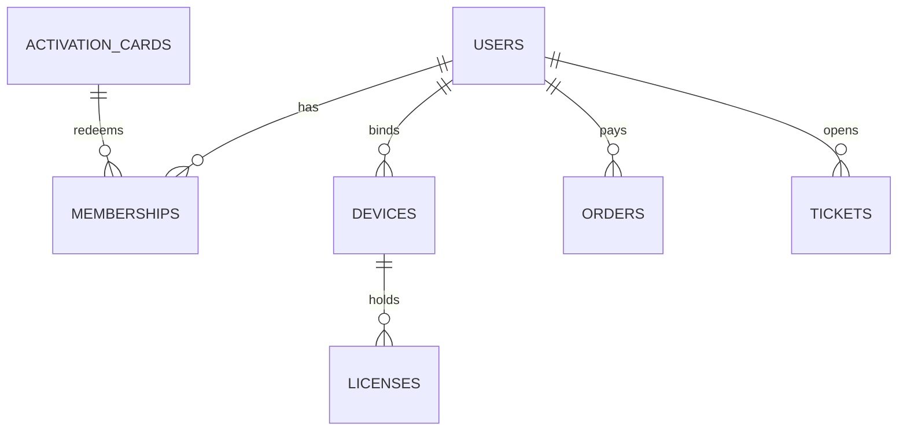

（客户端各表以 task_id / product_id / note_id 关联，不画 ER；字段即契约，见 §14.1。）

---

## 15. 部署、更新与配置下发

### 15.1 客户端发布管线

- 构建：electron-builder（NSIS / dmg），asar 打包，Windows 代码签名 + macOS notarization；
- 更新：electron-updater 差量更新；通道 = stable / beta；版本表在 B 端维护，可设「最低可用版本」强更；
- 灰度：按用户 ID 哈希分批放量；崩溃率阈值自动暂停放量。

### 15.2 配置与热更下发

| 下发物 | 签名 | 生效方式 |
|---|---|---|
| Feature Flag / 阈值 / 吊销名单 | 服务端响应签名 | 拉取即生效（冲突取保守值） |
| 适配层热更包（选择器/流程 DSL） | Ed25519 包签名 | 验签 → 兼容检查 → 自检用例 → 激活，失败回滚 |
| 违禁词库 | 随配置包 | 本地库替换 |

配置包签名校验失败或版本不兼容时：拒绝激活并沿用上一有效版本（含 Feature Flag/阈值/吊销名单），同时上报遥测；配置版本回退由 B 端配置中心提供（T-M5-03，S12）。

### 15.3 服务端部署

- 起步：单 VPS + Docker Compose（nginx / app / postgres / redis / minio），蓝绿可选；
- 监控：Prometheus + Grafana + Loki；告警通道（邮件/企业微信）；
- 备份：PostgreSQL 每日全量 + WAL 归档，异地副本；恢复演练每季度一次（M5 首验，T-M5-07）。
- 可用性预算（S7/NFR-4）：RTO ≤ 4h、RPO ≤ 24h；授权服务可用性单独计量（客户端 72h 宽限兑底）；Sentry 部署地域（私有化或境内）与 ICP/等保随合规缓冲阶段收口（PC-09）。

---

## 16. 分阶段交付路线图

| 里程碑 | 周期 | 范围 | 退出标准 |
|---|---|---|---|
| M0 地基 | 2 周 | Monorepo、Electron 壳、账号/授权链路、受控浏览器拉起与 CDP 接管、日志骨架 | 注册登录开卡全流程通；一键打开小红书并接管 |
| M1 洞察 | 3 周 | 笔记采集（反爬中间件 v1）、需求报告 Agent、报告 UI | 100 条采集完成率 ≥95%；报告八章节可用 |
| M2 选品 | 3 周 | 1688 适配层、选品 Agent、候选清单、收藏+询盘、素材留存 | 勾选→收藏→询盘→商品卡片全链路通 |
| M3 发布 | 3 周 | 文案生成、挑图裁剪、待审池、发布调度器、防重 | 队列 10 条零重复发布；失败有截图 |
| M4 推广 | 3 周 | 帖子筛选 Agent、评论待审、频控熔断、存活回采 | 频控硬上限生效；熔断演示通过 |
| M5 商业化 | 2 周 | 支付/激活码、B 端后台 P0 页面、自动更新、遥测 | 购卡→激活→使用闭环；看板上线 |
| 缓冲与合规审查 | 2 周 | 渗透测试、EULA/隐私政策、内容合规管线验收 | 外部测试报告通过 |

合计约 18 周（P0 范围）。P1/P2 项按里程碑间隙插入或进入 M6+ 迭代。

---

## 17. 风险登记册

| # | 风险 | 等级 | 缓解 |
|---|---|---|---|
| R1 | 平台改版导致适配层失效 | 高 | 特征校验自检 + 热更包机制 + B 端 Feature Flag 紧急关停（24h 响应 SLA） |
| R2 | 用户账号被平台风控 | 高 | 保守默认配额、硬上限、熔断、时段限制；EULA 明示；熔断遥测驱动策略迭代 |
| R3 | 平台法务/投诉 | 中高 | 合规定位（不绕过、不养号、不破解）、内容三道闸、类目黑名单、投诉处置 SOP |
| R4 | 会员体系被破解 | 中 | 签名许可证 + 设备绑定 + 完整性自检；接受单机可破的残余风险，靠快速热更与吊销名单对冲 |
| R5 | LLM 成本失控 | 中 | 任务级成本阈值 + Agent 步数/token 预算 + 缓存 |
| R6 | 单机数据损坏 | 中 | WAL + 备份包导出 + 迁移链测试 |
| R7 | 支付/激活码被刷 | 中 | 回调验签幂等、兑换限流锁码、风控告警 |
| R8 | 关键依赖（Playwright/Chromium）版本漂移 | 低 | 版本锁定 + 回归用例集（三大 flow 自检脚本随 CI 跑） |

---

## 附：文档间引用关系

- 需求条目：[01-需求说明书](./01-需求说明书.md) §3（FR-x）、§4（NFR-x）、§5（安全合规红线）；
- 本文档 §7 ↔ PRD §5.3（反爬策略）；§11 ↔ PRD §5.1/§5.4（威胁模型/密钥速查表）；§16 ↔ PRD §6（验收标准）。
