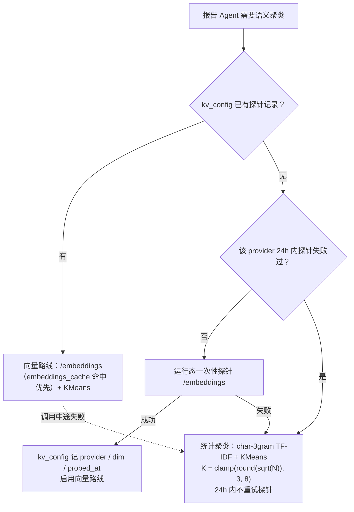

# ADR-7 嵌入来源决策（语义聚类嵌入路线）

> 任务：T-M1-01（计划 todo 3）· 定论依据：03-PRD与架构对齐审查报告.md:219（B-5）、04-架构评审报告.md:66-71（S5 定论，M1 编码前时限）、04:110-113（S5 放行条件）
> 日期：2026-10-13 · 状态：已接受（Accepted）· 关联：02-系统架构设计.md §8.2（report-agent）、§14.1（store v3 embeddings 表）；docs/adr/provider-matrix.md（§3 能力分档 / §4.2 嵌入缓存注记 / §5 M1 复跑记录）；docs/adr/sqlite-vec-packaging-validation.md（§3 / §7 打包加载事实）

## 1. 背景

- 语义聚类（需求报告 Agent ①场景聚类与热度）的嵌入来源在基线中二选一未决（03:219 B-5）：BGE 类本地小模型推理 vs 用户 LLM 嵌入接口。04:66-70（S5）指出两条路线各自的风险——本地模型引入模型分发体积（数百 MB）、许可证合规、Electron 内推理性能；用户接口引入嵌入接口兼容性（同 S4 能力碎片化）与额外成本。S5 要求 M1 编码前出本 ADR 定论。
- M1 期服务商能力实测矩阵已完成（provider-matrix.md §2/§3，2026-10-13）：五家预设中 zhipu 携真实 Key 实测为 **B 档**，其余四家仍为 [文档]/[网络不可达]；zhipu embeddings 格实测被账号余额（HTTP 429 code 1113）阻塞，**非能力否证**，维持 [文档]+「待实测」角标。

## 2. 决策

1. **V1 默认嵌入来源 = 用户 LLM 嵌入接口（BYOK）**，但不预设可用，以「**运行态一次性探针**」守门：
   - 首次需要向量路线时调用当前 provider 的 `/embeddings`：**成功** → 探针结果记入本地 `kv_config`（`{ provider, dim, probed_at }`），向量路线自此刻启用；
   - **失败**（端点不存在 / 被拒 / 网络 / 余额类错误）→ 自动降级统计聚类，且 **24h 内不对同一 provider 重试探针**（避免每次生成报告都撞墙；24h 窗口过后允许重试，覆盖「用户充值 / 换 Key」场景）。
2. **降级路线（一级常驻）= 统计聚类**：char-3gram TF-IDF 向量化 + KMeans，簇数 **K = clamp(round(sqrt(N)), 3, 8)**（N = 参与聚类的清洗后样本数）。无外部依赖、无网络调用，保证报告①章场景聚类在任何 BYOK 组合下恒可用（04:70 S5 降级建议的落地形态；层次聚类与 KMeans 二选一取 KMeans，K 公式将簇数约束在 3–8，匹配八章节报告的粒度需求）。
3. **本地模型路线（BGE 等）列二期**：分发体积、许可证合规与端内推理性能三前提在 V1 不解决（04:70）。
4. **向量表单表单 dim**：`embeddings_vec` 为 sqlite-vec vec0 虚拟表，**单表、维度固定**，dim 按默认嵌入档一次性锁定（候选见 §4：zhipu embedding-3，dim=2048，[文档] 源）。**dim 变更策略（写死）**：嵌入缓存全量失效（`embeddings_cache` 清空）+ `embeddings_vec` 表 DROP 后按新 dim 重建 + `kv_config` 探针记录更新；不做多 dim 分表矩阵（provider-matrix.md §4.2 的「按 dim 分表 vs 单表」决策点就此关闭）。三条打包/绑定铁律：
   - **rowid 必须 BigInt**：better-sqlite3 把 JS number 绑定为 REAL，vec0 拒收 REAL rowid——显式 rowid 一律传 `BigInt` 或用 SQL 字面量（sqlite-vec-packaging-validation.md §3-④ 实测结论）；
   - **加载路径 asar → app.asar.unpacked 替换**：`sqliteVec.getLoadablePath()` 返回 asar 虚拟路径，`db.loadExtension` 走 Win32 LoadLibrary、不经 Node dlopen 重映射，打包态必须显式 `replace('app.asar','app.asar.unpacked')`（sqlite-vec-packaging-validation.md §3-②；§7 pnpm 布局复验确认该规则原样可用）；
   - **本地嵌入缓存**沿用 provider-matrix.md §4.2 设计注记：`embeddings_cache(provider, model, input_sha256)` 去重、不存原文（隐私友好），命中避免对同一文本重复计费调用。

## 3. 降级链总览（探针 → 统计聚类 → 向量重建策略）

- 向量路线每次启用前校验 `kv_config` 探针记录与当前配置 provider 一致；不一致视为 dim/档位变更，走 §2-4 重建策略。
- 报告⑧章「数据来源与方法说明」必须如实标注当次实际使用的聚类路线（嵌入接口 / 统计聚类）与样本量，不允许把降级结果表述为向量结果。

## 4. M1 实测输入与角标约束（硬约束，如实采纳）

- **zhipu 实测 = B 档**（provider-matrix.md §3，2026-10-13）：tool calling **[实测通过]**（锚定模型 glm-4.7-flash，免费档，当日 3 次复现）；json_schema **[实测失败]** 实测确认不可用（HTTP 200 但空内容断言失败，两个独立负载窗口一致）；embeddings 格实测被账号 **1113「余额不足或无可用资源包」**阻塞（HTTP 429）——**非能力否证，维持 [文档]+「待实测」角标，不得当作 probed 输入**。此为硬约束，与 provider-matrix.md §3「R9 角标解除条件」及 `packages/llm-gateway/src/presets.test.ts` 防漂移断言同源：embeddings 格在获得有余额 Key 复测通过前，**不得**解除角标、不得升 `source:'probed'`。
- **对 M1 的直接推论**：
  1. **M1 报告 Agent 主路线 = 统计聚类**（char-3gram TF-IDF + KMeans，K=clamp(round(sqrt(N)),3,8)）——默认候选 provider 的 embeddings 尚无一格 [实测通过]，向量路线在探针通过前不得启用；
  2. **嵌入接口走「探针 + 降级链」**：运行态探针通过（用户充值后复测，或用户配置了 embeddings 实际可用的其他 provider / 自定义网关）才实际启用向量路线；
  3. **默认嵌入档候选 = zhipu embedding-3（dim=2048，[文档] 源）**：仅作为 dim 锁定值与探针目标档的候选输入；候选状态不构成能力承诺，R9 角标约束继续生效。
- **附注（chat 侧，非嵌入）**：M1 真实跑的 chat LLM 走用户 BYOK **自定义 base_url 网关**（02 §3.1：openai SDK 指向自定义 base_url，架构已支持），**不属于矩阵五预设、不新增预设**（用户 2026-10-13 决策）；provider-matrix 的五预设矩阵不因此改动。

## 5. 遗留与升级条款

| 触发条件 | 动作 |
|---|---|
| zhipu 账号充值后 embeddings 复测通过 | 按 provider-matrix.md §5 复跑流程升 [实测] 并存证；R9 角标解除（UI 文案 + presets `source:'probed'`）；运行态探针自动放行向量路线，本 ADR 主路线推论 1 失效 |
| 实测 dim ≠ 已锁 dim（默认档候选变更等） | 触发 §2-4 重建策略：`embeddings_cache` 全量失效 + `embeddings_vec` DROP 重建（store v3 迁移注释写明），探针记录随新 dim 更新 |
| 用户配置其他 embeddings 实际可用的 provider（含自定义 base_url 网关） | 探针对当前 provider 生效，通过即启用向量路线；默认档候选与矩阵不因此变更 |
| 二期启动本地模型路线 | 另立 ADR 修订本决策（分发体积 / 许可证 / 端内推理性能三前提重评），不回改本文结论 |

## 6. 下游引用

- **T-M1-05（报告 Agent）**：聚类路线路由（探针/降级链）、K 公式、⑧章方法说明如实标注；
- **store v3（迁移实现）**：`embeddings_cache` / `embeddings_vec` 单表单 dim DDL、BigInt rowid、asPath 加载封装、dim 变更重建的迁移注释；
- **T-M1-08（BYOK 界面）**：嵌入能力承诺文案遵守 R9「文档源，待实测」角标约束。
